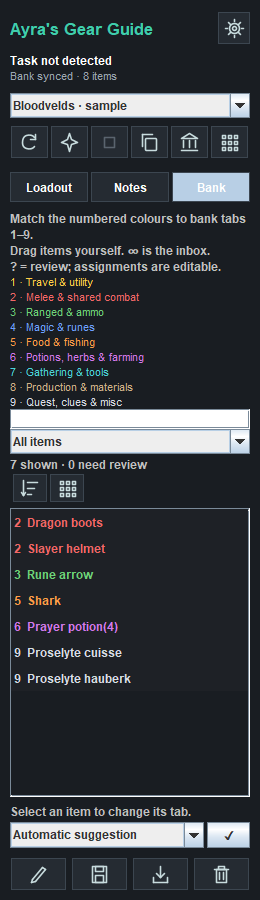

# Ayra's Gear Guide

Gear setups and bank organization for RuneLite, with optional AI assistance.



## Features

- Save your equipped gear and inventory as an editable, per-account setup.
- Keep exact equipment slots, a 28-slot inventory, and Markdown task notes together.
- Check owned quantities, known skill requirements, two-handed weapons and shields, and potion-storage doses.
- Display a saved setup as a temporary Bank Tags layout, with readiness colours in the sidebar.
- Include editable rune supplies below the loadout in the bank, with required quantities in the sidebar.
- Categorize bank items into nine numbered colours, search and filter them, and save your own category assignments.
- Group the current bank view visually without moving stored items.
- Optionally match saved setups to a Slayer task and combat style.
- Optionally generate a setup through your chosen AI provider, or connect a local assistant.

There is no pathfinding, travel overlay, automatic movement, automatic withdrawal, equipping, banking, combat, or offer placement. Directions and its Shortest Path integration were removed from this release.

## Basic use

Enable **Ayra's Gear Guide** and its built-in **Bank Tags** dependency. Log in and open your bank. Open potion storage once per login if you use stored potions.

Use the save icon to capture your current equipment and inventory. Review the name, combat style, target, items and notes, then save. The pencil edits an existing setup. **Loadout**, **Notes**, and **Bank** are always visible navigation buttons; changing pages preserves the controls on each page.

The bank icon displays the selected loadout in the bank. The grid icon returns to the ordinary bank view. Green means the item is in its intended slot; gold means it is owned but needs moving; red means a quantity or known requirement is missing. Withdraw and equip items yourself.

In the setup editor, use **Edit runes** to add the rune types and quantities needed for your pouch or item charges. They appear in separate rows below equipment and inventory in the bank, and under **Rune supplies** in the sidebar. These are additional supplies, not extra inventory slots. Fill your pouch or charge items manually; the plugin does not read pouch contents or calculate runes from spell selections or notes. Existing setups keep working and can have rune supplies added through the editor.

For stored potions, select the withdrawal dose shown in the setup. Bottle sizes share one dose pool and cannot be counted independently.

The **Bank** page shows category suggestions. A `?` marks an unverified suggestion. Select an item and destination to save your own assignment. The grouping button creates a temporary visual arrangement; it does not reorganize your physical bank tabs. Return to the ordinary bank before dragging items.

## Optional AI generation

No provider account or API key is needed for manual setups and bank tools. In settings, choose a provider, enter a model ID supported by that provider and supply your own key. Keys are kept in memory for that plugin session, not written to configuration, exported, or exposed through the assistant connection. Provider/model choices are saved locally.

Requests run only when you choose **Request a build** and accept the data-sharing dialog. The chosen provider receives your task, bank items, equipment, inventory, skill levels, known potion storage and entered preferences. Account IDs and snapshot revisions are removed. Provider usage charges may apply. There is no periodic or automatic AI generation.

The result must pass the same ownership, quantity and skill validation as manual setups. Review it before saving. The integration has no live Wiki lookup and cannot verify all mechanics, quests or unlocks. Cancelling discards the result, but does not guarantee that the provider avoided a charge.

## Optional local assistant connection

The connection is **off by default**. Enable it explicitly in settings and restart the plugin to use the included `bridge.ps1` helper. Ordinary gear and bank features continue working if the chosen port is unavailable.

When enabled, it binds to `127.0.0.1` only and uses a new random bearer token each start. It rejects browser-origin requests, unexpected host headers and non-local connections. It exposes snapshots and saved-setup operations; it has no gameplay-action endpoints and does not expose provider keys.

Discovery is stored in `.runelite/gear-guide/connection.json`. The token is private; do not share or commit this file. `bridge.ps1` reads the file without printing the token. See [the local API guide](docs/LOCAL_API.md).

## Data and limitations

Saved setups, cached bank observations, category overrides and non-secret provider/model choices live in `.runelite/gear-guide/`, separated by account where appropriate. Account identifiers are derived from the game account hash. A cached bank can be stale; reopen it to refresh quantities. Logging out clears the live shared snapshot. Potion storage must be observed each login.

The plugin does not read rune-pouch contents, item charges, other storage, quest completion, diaries or all unlocks. Its equipment-requirement table has incomplete coverage: an unknown requirement prevents a new recommendation unless that item is currently worn. Ornamented Void variants inherit their base item's requirements. Gear suggestions and category heuristics are not measured DPS rankings or instructions to discard items.

## Development

Use JDK 17 and the included Gradle wrapper:

```text
gradlew.bat test jar
gradlew.bat run
```

The default development dependency is RuneLite `latest.release`. Reproducible validation for this release used RuneLite **1.13.3**, selected with `-PruneLiteVersion=1.13.3`. The normal plugin artifact contains only Ayra's Gear Guide; `shadowJar` and the Windows launch scripts are optional development conveniences that bundle a client for local testing. They are not the Plugin Hub submission format.

```text
gradlew.bat -PruneLiteVersion=1.13.3 test jar shadowJar preview
```

Tests cover validation, account separation, saved builds, potion pools, local HTTP authorization, AI response validation, bank assignments and sidebar interaction. Preview screenshots use labelled sample data.

## Plugin Hub submission

Publish the source repository and submit a marker containing its HTTPS Git URL and exact commit hash to [RuneLite's Plugin Hub](https://github.com/runelite/plugin-hub). RuneLite reviews and builds the source; uploading the development client JAR is not a submission. This package has not been approved or installed through the Hub.

Code is BSD-2-Clause. Bundled data has separate attribution and licensing described in [THIRD_PARTY_NOTICES.md](THIRD_PARTY_NOTICES.md); the code license does not replace those data terms.
